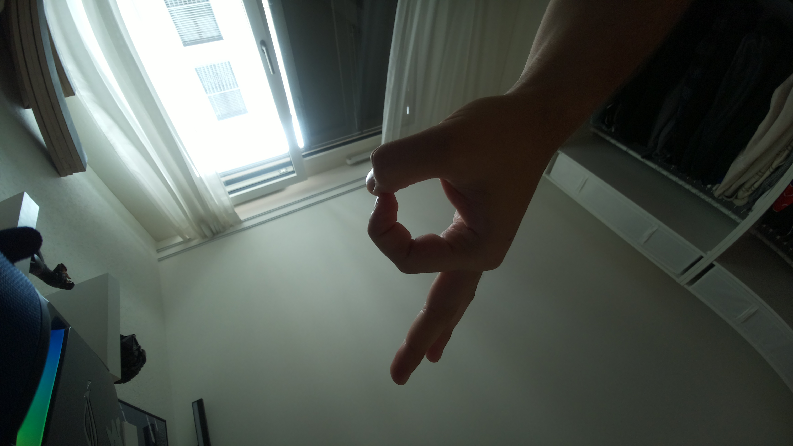
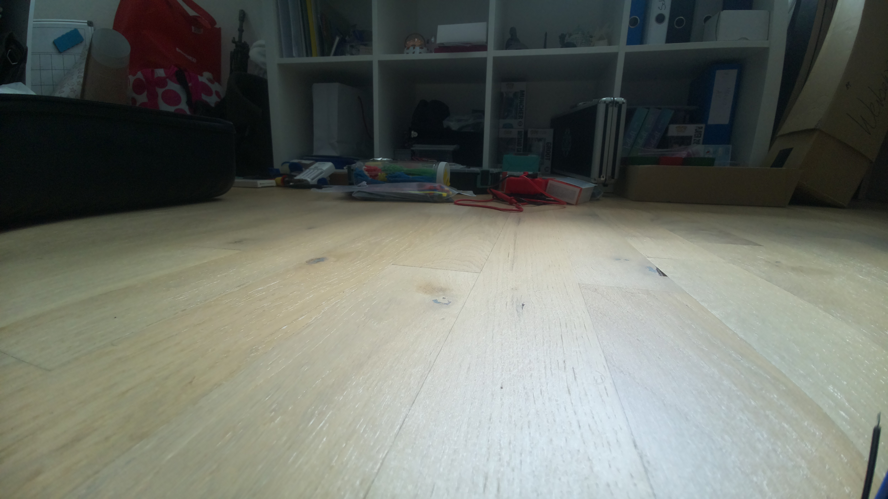

# Hardware Tests

Dieser Ordner enthält die Testprogramme zur Inbetriebnahme und Funktionsprüfung der einzelnen Hardwarekomponenten des autonomen Robotikfahrzeugs.

Die Programme wurden zunächst unabhängig voneinander ausgeführt, um die Verdrahtung und Funktion der jeweiligen Komponenten zu überprüfen.

Enthalten sind bzw. werden unter anderem Tests für:

- Ultraschallsensoren
- TB6612FNG-Motortreiber und DC-Motoren
- Status-LEDs
- Starttaster
- Testbilder zur Überprüfung der Kameraaufnahme und Bildausrichtung

Die Testprogramme dienen zu diesem Zeitpunkt für die Technische Kontrolle der Hardwarekomponente. 

# Kamera
Erste Bildaufnahme der Kamera. Festgestellt dass "umgekehrt" montiert wurde

In der Software mit

rpicam-still --rotation 180 -o testbild_180.jpg

Neues Bild aufgenommen. Nicht mechanisch gekehrt, 180 Grad Rotation passiert in der Software.

