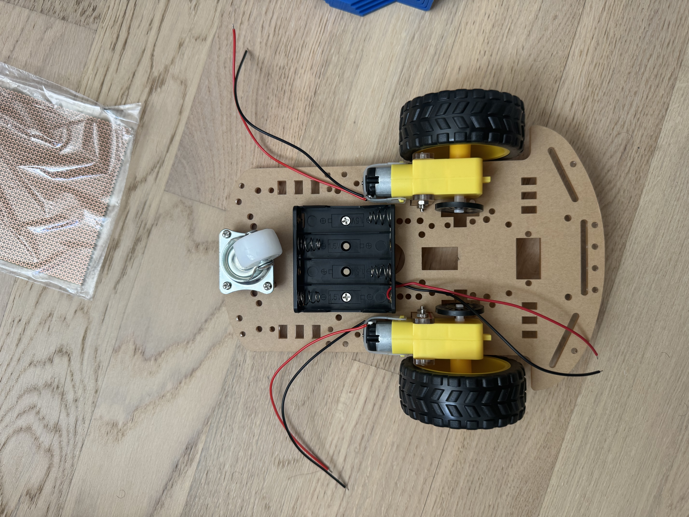
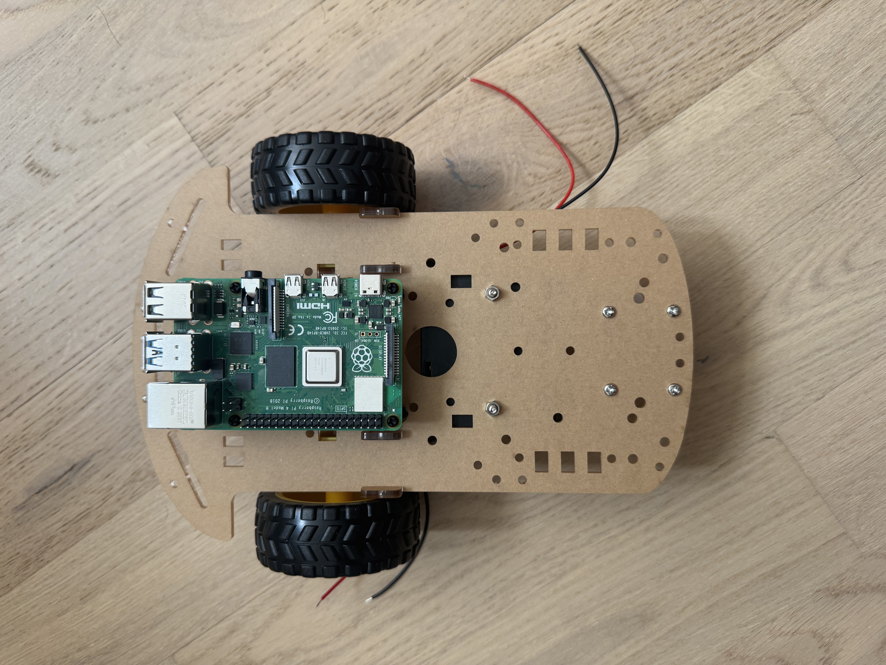
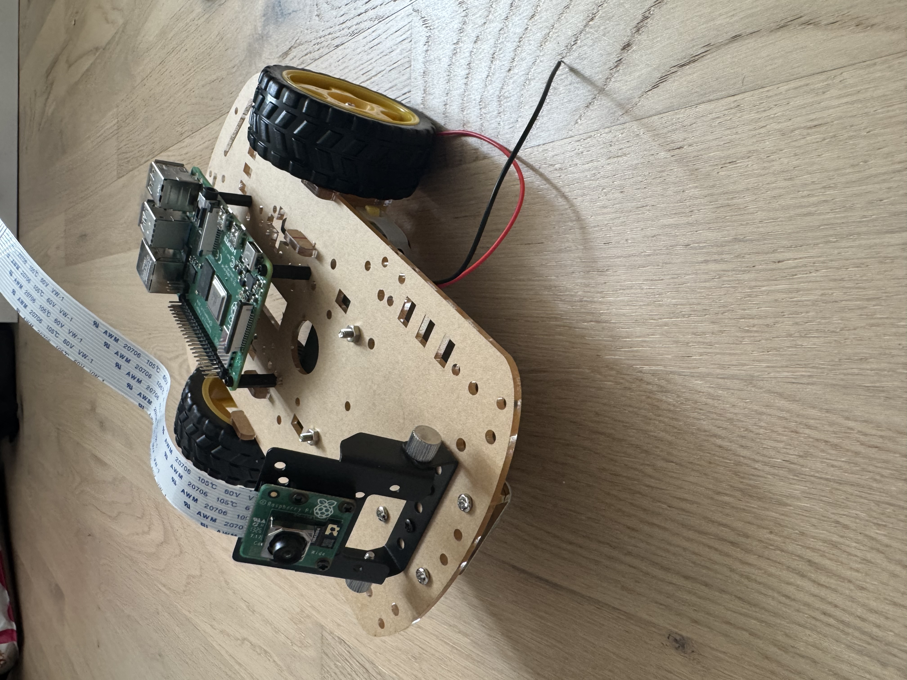
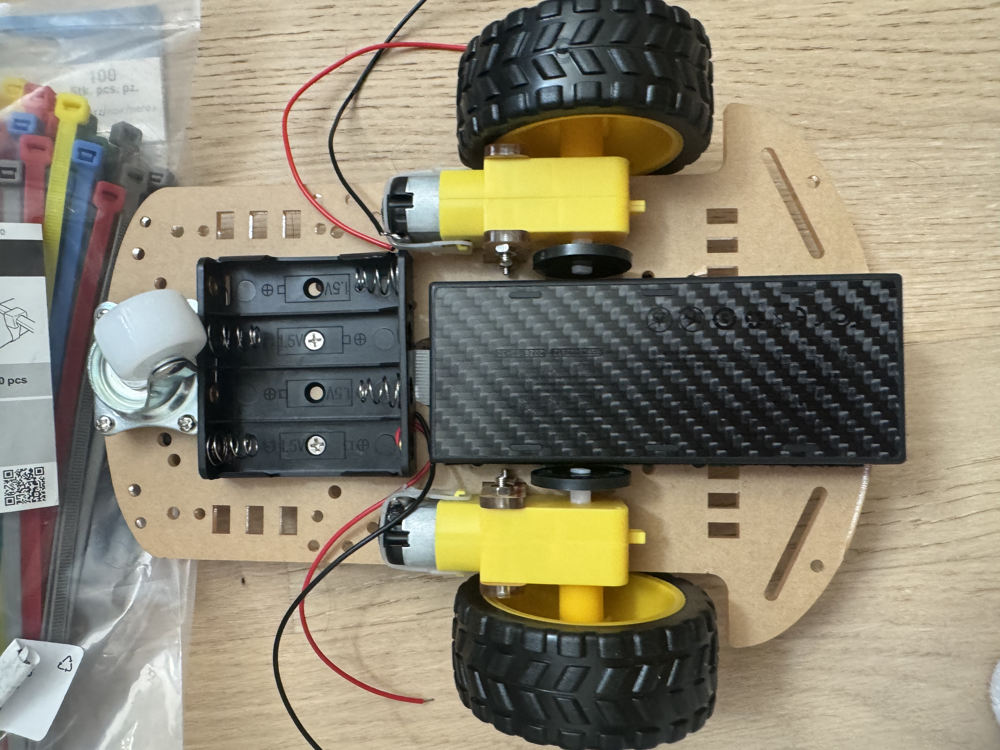
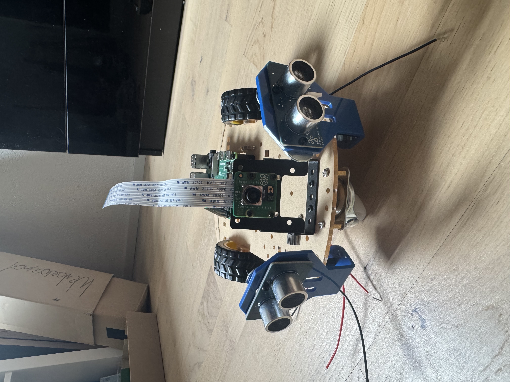
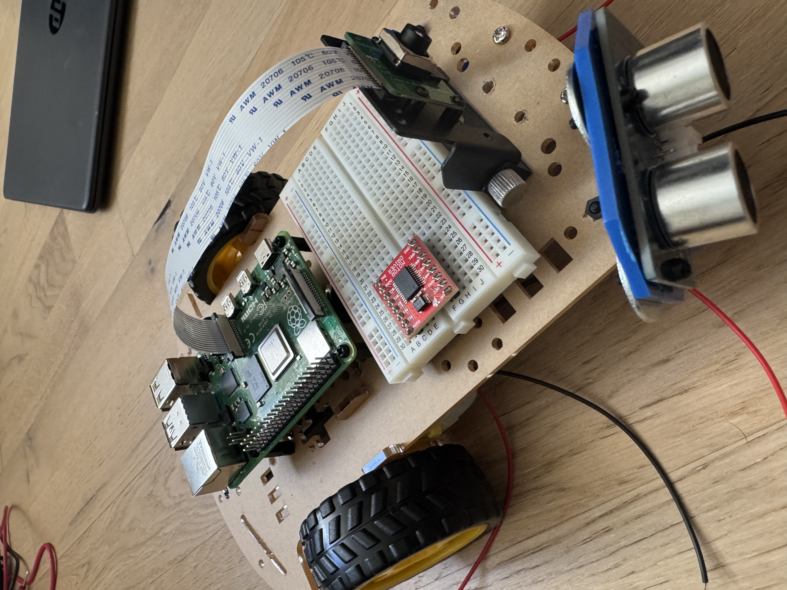
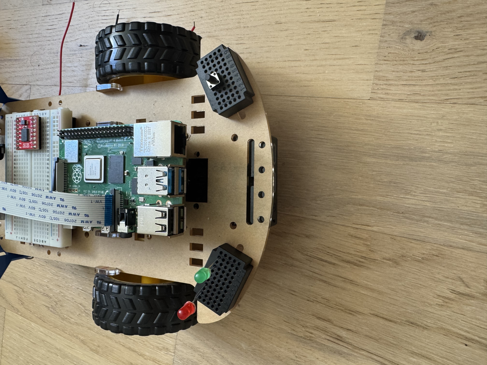
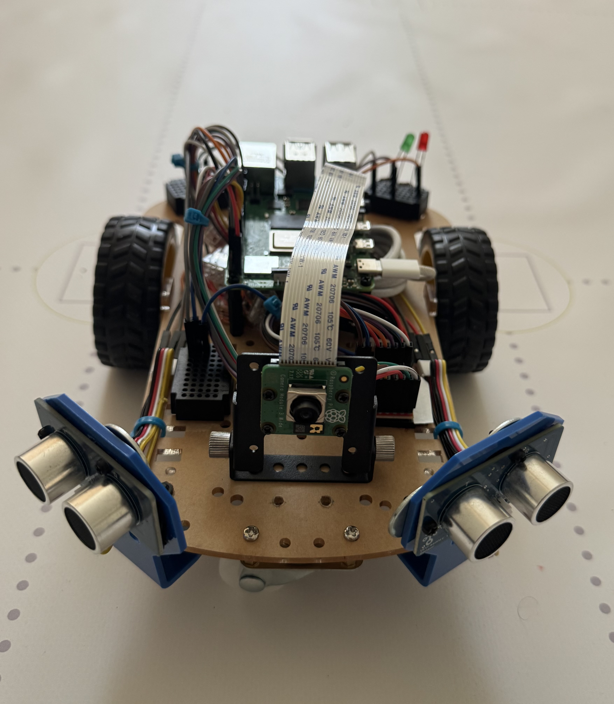

# Mechanischer Aufbau 
 
Dieser Ordner dokumentiert den mechanischen Aufbau des autonomen Fahrzeugs.  
Die einzelnen Hardwarekomponenten wurden schrittweise auf dem Chassis montiert  
und ihre Position während des Aufbaus teilweise angepasst. 
 
## 1. Chassis 
 
Zuerst wurde das Stützrad montiert. Anschließend wurden die Akkupacks auf der  
Unterseite des Chassis befestigt, damit auf der Oberseite ausreichend Platz für  
die weiteren Hardwarekomponenten vorhanden bleibt. 
 
Die Leitungen der DC-Motoren wurden zusätzlich mit Schrumpfschlauch geschützt. 

 
 
## 2. Raspberry Pi 
 
Für die Montage des Raspberry Pi wurden zusätzliche Löcher in das Chassis gebohrt.  
Die Recheneinheit wurde mit Abstandshaltern befestigt und bewusst eher im hinteren  
Bereich positioniert, damit vorne genügend Platz für die Sensorik vorhanden bleibt. 
 
 
 
## 3. Kamera 
 
Die Kamera wurde mit einer passenden Halterung im vorderen Bereich des Fahrzeugs  
montiert. Dafür wurden zusätzliche Befestigungslöcher in das Chassis gebohrt. 
 
Die Position wurde so gewählt, dass die Kamera den Streckenverlauf möglichst gut  
erfassen kann. 
 
 
 
## 4. Stromversorgung 
 
Die Powerbank zur Versorgung des Raspberry Pi wurde mit Klettband am Chassis  
befestigt. Die Akkupacks für den Antrieb wurden auf der Unterseite positioniert. 
 
Während des Aufbaus wurde deren Position leicht angepasst, um die Gewichtsverteilung  
und die Kabelführung zu verbessern. 
 
 
 
## 5. Ultraschallsensoren 
 
Die Ultraschallsensoren wurden mit entsprechenden Halterungen am Chassis befestigt. 
 
Zusätzlich wurde an bestimmten Stellen Klettband als Schutz verwendet, damit  
metallische Befestigungsteile keinen direkten Kontakt mit elektronischen Teilen  
der Sensoren haben. 
 
 
 
## 6. Motortreiber 
 
Der TB6612FNG-Motortreiber wurde auf einem Breadboard montiert. Das Breadboard  
wurde anschließend mit Klettband auf dem Chassis befestigt. 
 
Dadurch konnte eine geeignete Montagefläche für den Motortreiber und dessen  
Verdrahtung geschaffen werden. 
 
 
 
## 7. LED und Starttaster 
 
Für die Status-LEDs, den Starttaster und mögliche spätere Erweiterungen wurden  
kleine Breadboards am Fahrzeug montiert. 
 
Dafür wurde eine vorhandene Öffnung im Chassis leicht angepasst, sodass die  
Breadboards befestigt werden konnten. 
 
 
 
## 8. Fertiger mechanischer Aufbau 
 
Nach der Montage aller Hardwarekomponenten wurde die Verdrahtung durchgeführt  
und die Kabelführung anschließend mit Kabelbindern optimiert. 
 
Damit ist der mechanische und elektrische Aufbau für die weitere  
Softwareentwicklung und die Tests auf der Teststrecke vorbereitet. 
 

