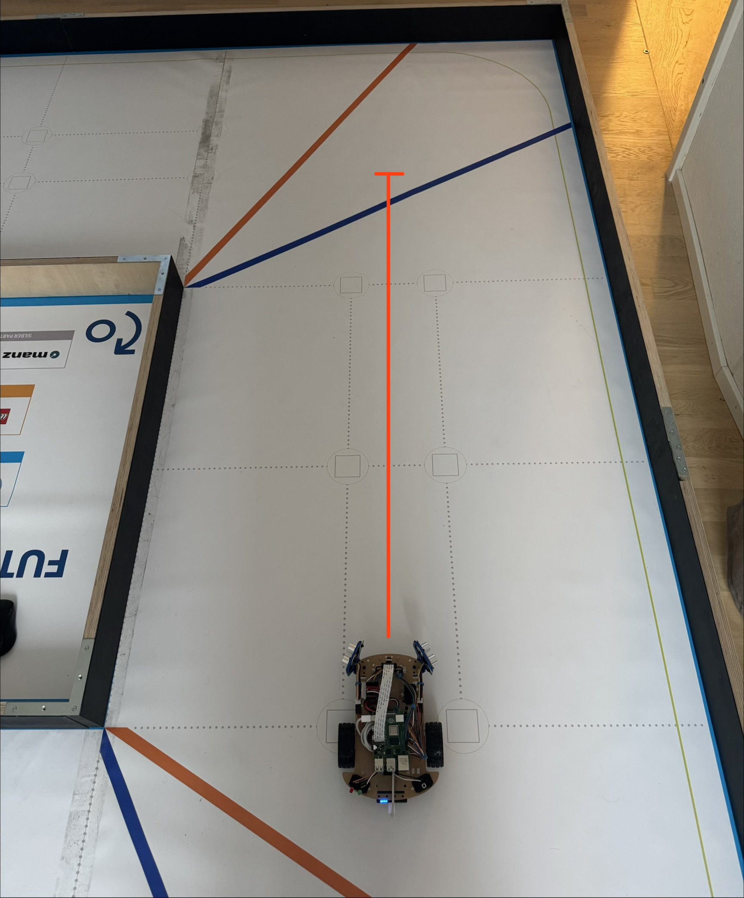
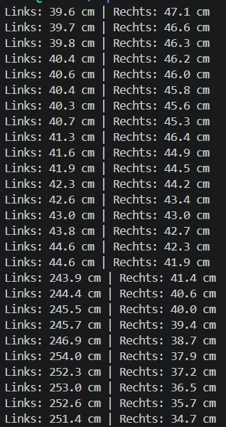

# Wandabstand

In diesem Test wird die Abstandsmessung der beiden seitlich montierten Grove Ultrasonic Ranger auf der realen Teststrecke untersucht. Die gewonnenen Messwerte dienen später als Grundlage für die Korrektur des Fahrverhaltens und zur Vermeidung von Wandkontakt.

## 1. Statische Abstandsmessung

Im ersten Schritt wurde das Fahrzeug an verschiedenen Positionen auf der Teststrecke platziert. Die von den Ultraschallsensoren ermittelten Abstände wurden mit den tatsächlichen Abständen zur Wand verglichen.

Zur Kontrolle wurde der reale Abstand zwischen Sensor und Wand mit einem Massstab gemessen und anschliessend mit den ausgegebenen Sensorwerten verglichen.

Die Messungen zeigten über verschiedene Positionen eine Abweichung von ungefähr ±0,5 bis 1 cm. Beide Ultraschallsensoren lieferten dabei überwiegend stabile und plausible Werte.

Um die Messwerte zu prüfen wurde `ultrasonic_both.py` verwendet.

*Vergleich der Ultraschallmessung mit dem tatsächlichen Abstand zur Wand.*

*Gleichzeitige Ausgabe der Messwerte des linken und rechten Ultraschallsensors.*

## 2. Abstandsmessung während der Fahrt

Nach der statischen Überprüfung wurden die beiden Ultraschallsensoren während der Fahrt auf der Teststrecke getestet. Das Fahrzeug fuhr dabei mit den zuvor ermittelten PWM-Grundwerten von 70 % für den linken und 71 % für den rechten Motor einen geraden Streckenabschnitt entlang.

Während der Fahrt wurden die Messwerte beider Ultraschallsensoren kontinuierlich im Terminal ausgegeben. Die Abstände veränderten sich entsprechend der Position des Fahrzeugs nachvollziehbar.

Besonders deutlich zeigte sich das Verhalten beim Verlassen eines Bereichs mit seitlicher Wand. Sobald auf einer Seite keine Wand mehr erfasst wurde, stieg der entsprechende Messwert deutlich an, während der gegenüberliegende Sensor weiterhin plausible Abstandswerte lieferte.

*Fahrtrichtung des Fahrzeugs während des dynamischen Wandabstandstests.*

*Kontinuierliche Ausgabe der linken und rechten Abstandsmessung während der Fahrt.*
