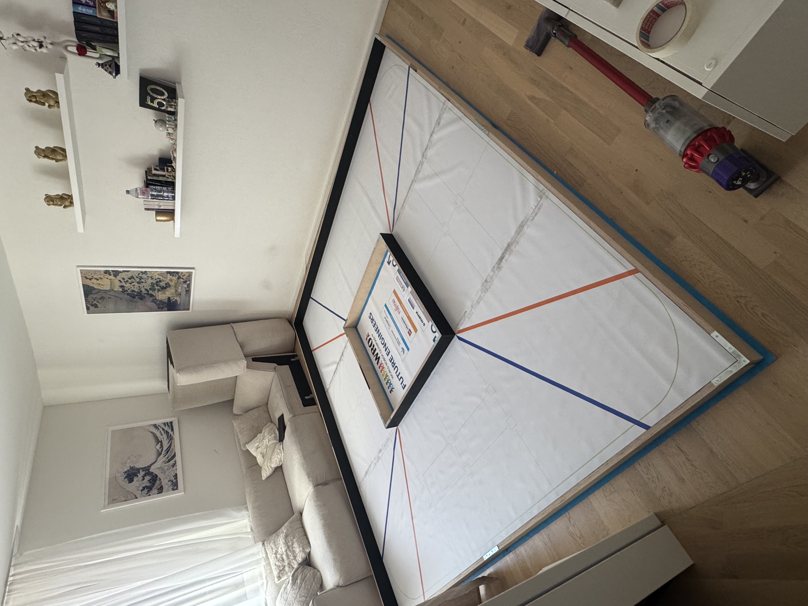
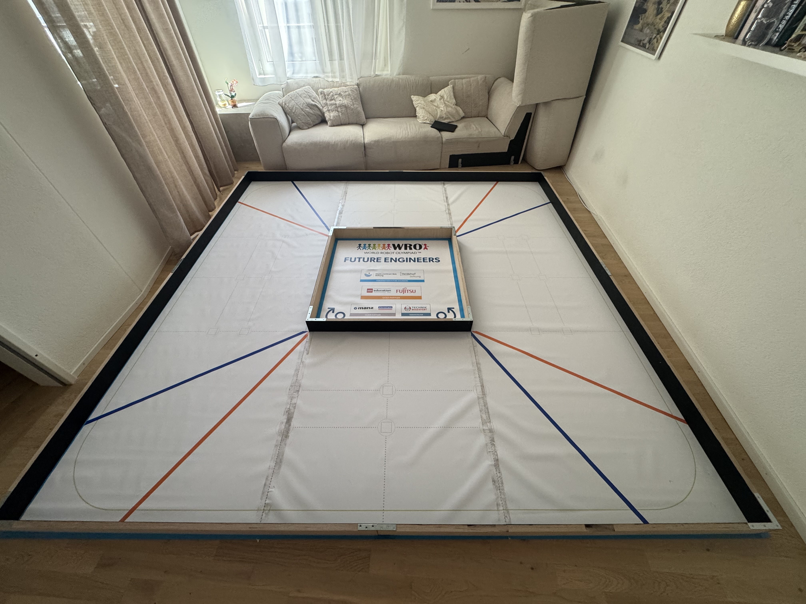

# Testumgebung

Für die praktische Entwicklung und Validierung des autonomen Fahrzeugs wurde eine Teststrecke mit innerer und äusserer Begrenzung sowie blauen und orangefarbenen Kurvenmarkierungen aufgebaut.

Die Testumgebung dient zur Ermittlung der Fahrparameter sowie zur schrittweisen Entwicklung und Überprüfung der vorgesehenen Fahrzeugfunktionen. Dazu gehören die Abstandserfassung, die Erkennung von Kurvenmarkierungen und farbigen Hindernissen sowie die daraus resultierenden Fahrmanöver.

## Aufbau der Teststrecke

*Gesamtansicht der aufgebauten Teststrecke.*

*Weitere Ansicht der Teststrecke mit innerer und äusserer Begrenzung.*
