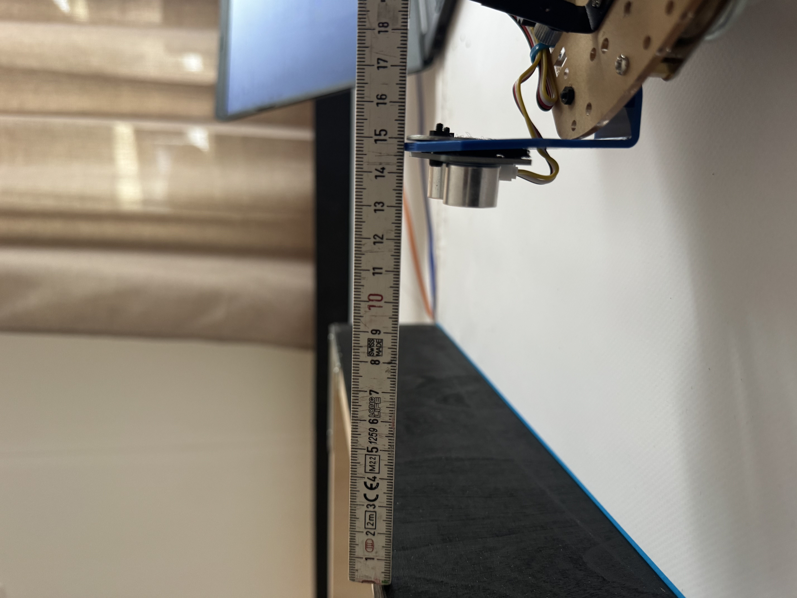
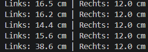

# Wandabstand

In diesem Test wird die Abstandsmessung der beiden seitlich montierten Grove Ultrasonic Ranger auf der realen Teststrecke untersucht. Die gewonnenen Messwerte dienen später als Grundlage für die Korrektur des Fahrverhaltens und zur Vermeidung von Wandkontakt.

## 1. Statische Abstandsmessung

Im ersten Schritt wurde das Fahrzeug an verschiedenen Positionen auf der Teststrecke platziert. Die von den Ultraschallsensoren ermittelten Abstände wurden mit den tatsächlichen Abständen zur Wand verglichen.

Zur Kontrolle wurde der reale Abstand zwischen Sensor und Wand mit einem Massstab gemessen und anschliessend mit den ausgegebenen Sensorwerten verglichen.

Die Messungen zeigten über verschiedene Positionen eine Abweichung von ungefähr ±0,5 bis 1 cm. Beide Ultraschallsensoren lieferten dabei überwiegend stabile und plausible Werte.

*Vergleich der Ultraschallmessung mit dem tatsächlichen Abstand zur Wand.*

*Gleichzeitige Ausgabe der Messwerte des linken und rechten Ultraschallsensors.*

## Zwischenstand

Die statischen Messungen zeigen, dass beide Ultraschallsensoren für die weitere Ermittlung des Wandabstands verwendet werden können.

Als nächster Schritt wird das Verhalten der Abstandsmessung während der Fahrt untersucht. Dabei soll geprüft werden, wie stabil sich die Messwerte bei einem fahrenden Fahrzeug verhalten. Auf Grundlage dieser Versuche werden anschliessend geeignete Abstandsgrenzen für die spätere Fahrkorrektur bestimmt.
